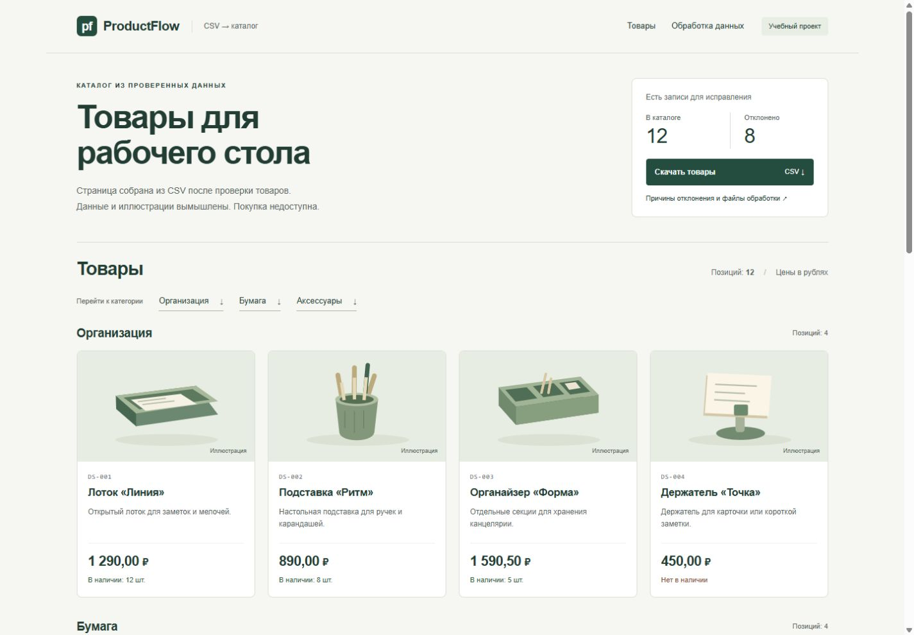

# ProductFlow — товарный каталог из CSV

**Учебный проект на синтетических данных, подготовленный с использованием AI.**
Коммерческого заказчика и внедрения нет. Это пример обработки данных, статического интерфейса и проверяемого результата.

CSV → проверка → нормализация → отчёт → HTML-каталог.

[Открыть готовый каталог](https://robengood.github.io/productflow-demo/) · [Посмотреть исходники и тесты](https://github.com/robengood/productflow-demo)

Python отдельно обрабатывает CSV. GitHub Pages показывает готовый статический каталог; загрузки и обработки файла в браузере нет.



## Запуск за три шага

Требуется установленный Python 3.10+; для нового запуска рекомендуем Python 3.12 или новее.
[Официальная установка для Windows](https://www.python.org/downloads/windows/). Приложение и тесты используют только стандартную библиотеку.
Фактически проверено на Python 3.12.14 / Windows 11. Откройте терминал в папке с этим README.

```powershell
py -3 catalog.py data/products_demo.csv --output output
py -3 -m unittest discover -s tests -v
py -3 -m http.server 8766 --bind 127.0.0.1 --directory output
```

Откройте http://127.0.0.1:8766/ в браузере. Для остановки сервера нажмите Ctrl+C.
Если в Windows нет команды `py`, используйте `python`; на macOS/Linux — `python3`.
Если `py -3` сообщает «No installed Python found!», сначала установите Python,
закройте и снова откройте терминал. Проверьте `py -3 --version` или `python --version`.
В аудите использован доступный интерпретатор Python 3.12.14; наличие рабочего `py` на этом компьютере не подтверждено.
HTTP-сервер нужен только для локального просмотра готовых файлов: он не обрабатывает CSV.

Готовая сборка находится в `output/`. Её можно открыть как локальный HTML, но режим `file://`
в текущей проверке браузером не тестировался. Для воспроизводимого просмотра и скачивания используйте HTTP выше.

## Подтверждённый результат

20 исходных записей → **12 товаров + 8 отклонённых записей**.
В отчёте 10 ошибок: одна запись может содержать несколько.
В журнале **11 изменений формата** принятых данных. **46 автоматических тестов прошли**.
Подробности и ограничения: [QA-отчёт](docs/QA_REPORT.md).

## Вход и правила

Формат UTF-8 с BOM или без него, до 5 МиБ (5 × 1024 × 1024 байт).
Разделитель по умолчанию `;`; для `,` передайте `--delimiter ,`.
Заголовки точные, порядок произвольный. Лишний, повторный или отсутствующий обязательный столбец — ошибка файла.

| Поле | Правило |
| --- | --- |
| sku | Обязательно; 1–32 символа ASCII: A–Z, 0–9, _ и -; первый символ — буква или цифра. Допускается нижний латинский регистр, он переводится в верхний. |
| name | Обязательно, до 100 символов. |
| category | Организация, Бумага или Аксессуары; регистр и пробелы нормализуются. |
| price | Рубли; больше 0 и не больше 1 000 000; до двух десятичных знаков. Примеры: 1290, 1290.50, 1 290,50. Не округляется. |
| stock | Целое число от 0 до 999999; 0 — нет в наличии. |
| description | Необязательно, до 500 символов. |

В текстах крайние пробелы убираются, внутренние пробелы и переносы сворачиваются.
Все изменения принятых значений записываются с точными «до» и «после».
Неоднозначные цены, неизвестные категории и все повторы артикула отклоняются до ручного исправления.
Пустые записи и несовпадение числа столбцов попадают в отчёт. Невидимые управляющие символы запрещены;
табуляция и переносы разрешены как форматирование пробелов.

Тексты названия и описания с начальным =, +, -, @ отклоняются для ручной проверки.
Это консервативное правило против формул: оно может отклонить допустимое название.
В CSV-отчётах такие значения защищены апострофом, скрытые символы видны как \u0000.
Точные исходные значения остаются в JSON. HTML-символы экранируются.

## Выходные файлы

| Файл | Что содержит |
| --- | --- |
| output/normalized.csv | Принятые товары в исходной схеме. Можно снова передать обработчику без удаления столбцов. |
| output/issues.csv | Номер записи, артикул, поле, код ошибки, значение и причина. |
| output/changes.csv | Номер записи, поле, значение до и после нормализации. |
| output/report.json | Сводка, ошибки, изменения, исходные отклонённые записи целиком, связь SKU с номером записи и SHA-256 входа. |
| output/index.html | Готовый каталог. Рядом style.css и assets/. |
| output/pdf/portfolio_case.pdf | Трёхстраничный кейс с реальными скриншотами и примерами. |

`source_record` считает CSV-записи вместе с заголовком (первая товарная — 2).
`source_line_end` — физическая строка окончания записи; внутри кавычек возможны переносы.
Принятые исходные значения восстанавливаются из normalized.csv и журнала изменений;
отклонённые массивы ячеек сохранены в report.json.

Сборка перезаписывает одноимённые выходные файлы. Для эксперимента используйте отдельную папку:

```powershell
py -3 catalog.py data/empty.csv --output tmp/empty-preview
py -3 catalog.py data/all_invalid.csv --output tmp/invalid-preview
py -3 catalog.py output/normalized.csv --output tmp/roundtrip --strict
```

Коды завершения: **0** — обработка выполнена (ошибочные записи могут быть исключены);
**1** — найдены ошибки записей при `--strict`, отчёты всё равно созданы;
**2** — ошибка чтения, схемы или записи файлов.
Неверный вход не заменяет прежние результаты. Проверяйте код завершения, чтобы не принять старую сборку за новую.

## Устройство проекта

- `catalog.py`: чтение, правила, отчёты, экранирование и заполнение HTML-шаблона.
- `templates/`: HTML и адаптивный CSS без JavaScript.
- `assets/`: собственные SVG-иллюстрации. Для 12 демонстрационных SKU — отдельные рисунки; для других SKU — заглушка.
- `data/`: основной набор, пустой каталог и пример с отклонением всех записей.
- `tests/test_catalog.py`: 46 тестовых методов с дополнительными наборами значений.
- `evidence/`: реальные журналы проверок, скриншоты, контрольные суммы.
- [Предрелизный аудит](docs/PRE_RELEASE_AUDIT.md), [разбор тестов](docs/TEST_REVIEW.md), [происхождение ресурсов](docs/ASSET_PROVENANCE.md), [исторический аудит](docs/AUDIT.md), [QA](docs/QA_REPORT.md), [понятный разбор](docs/LEARNING_GUIDE.md), [описание кейса](docs/CASE.md).
- [Как обновляется публикация](docs/PUBLISHING.md): структура репозитория и ручной запуск GitHub Pages.

## Повторение проверок и подготовка материалов

`python tools/record_checks.py` запускает тесты, пересобирает пример и проверяет согласованность артефактов.
Скриншоты сделаны в настоящем браузере; их обновление требует отдельного просмотра, скрипт их не имитирует.
`tools/prepare_screenshot_crops.py` только вырезает фрагменты сохранённых полных снимков.

Для пересборки PDF нужны дополнительные библиотеки: `python -m pip install -r tools/requirements-pdf.txt`,
затем `python tools/build_pdf.py`. Они не нужны для каталога.
`python tools/package_project.py` готовит локальные архивы выпусков в `../release/`
и проверяет их содержимое. Эта команда не публикует файлы. Для просмотра исходников
в GitHub используется структура папок в корне репозитория; GitHub Pages отдельно
собирает статический каталог через workflow из `.github/workflows/pages.yml`.

## Ограничения

Это статический каталог. CSV обрабатывается в терминале, загрузки через браузер нет.
Категории — ссылки перехода, а не фильтры. Нет корзины, оплаты, базы данных, CMS или API.
Категории и ограничения чисел заданы для этого примера; импорт в конкретную CMS требует согласования.
Изображения привязаны к демонстрационным SKU, не подбираются по смыслу новых товаров.
Выходные файловые ссылки отклоняются. Комплект готовится до замены; при обычной ошибке записи выполняется откат.
При аварийном завершении процесса или параллельных запусках целостность нескольких файлов не гарантируется.
При сбое самого отката сохраняется резервная папка `.productflow-*` и выдаётся сообщение восстановления.
Нагрузочные испытания, полный аудит доступности и проверка Safari/Firefox не проводились.
[Каталог](https://robengood.github.io/productflow-demo/) · [Репозиторий](https://github.com/robengood/productflow-demo) · [GitHub Actions](https://github.com/robengood/productflow-demo/actions/workflows/pages.yml).

